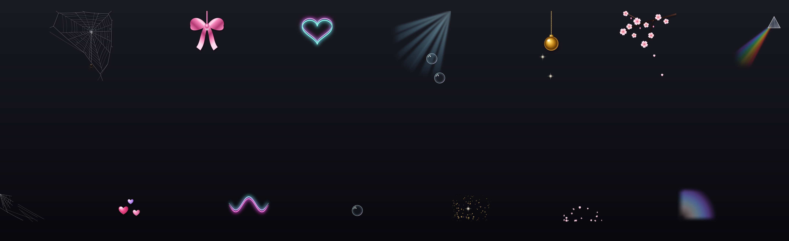
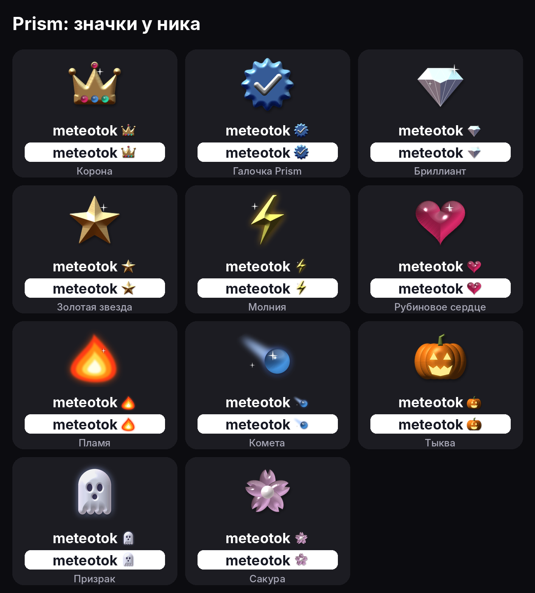
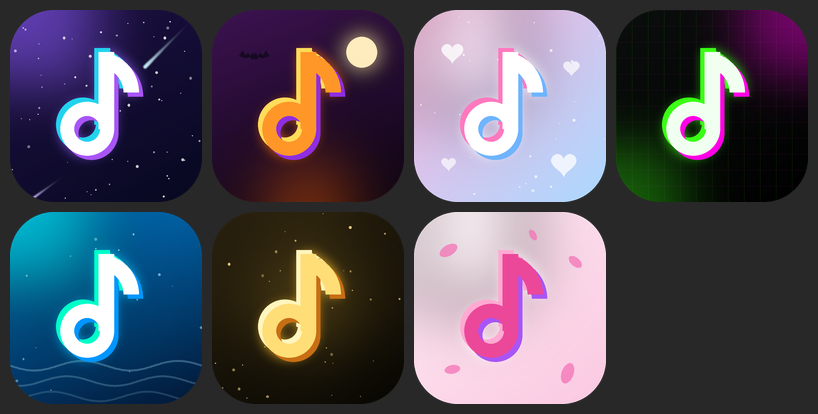

# 💎 Prisma TikTok

**Чистый и красивый TikTok без рекламы, с подменой региона, темами и бейджами.**

[**⬇️ Скачать Prisma 1.0**](https://github.com/meteotok/prisma-tiktok/raw/main/download/prisma-1.0.mpp) · [**✈️ Канал в Telegram**](https://t.me/prisma_tiktok)

---

## Что это

Prisma — набор патчей для TikTok, который ставится через **Morphe Manager** на твой собственный APK.
Никаких левых сборок APK: ты патчишь оригинальный TikTok сам, у себя на телефоне.

## Что нового в 1.0

- 🖼 **Баннеры в профиле**: шапки профилей, как в обычном TikTok
- 🇺🇸 **Регион по умолчанию США**: в поиске появляются Ask Tako, Shop и подборки, например оттенки по запросу Makeup
- 📍 В настройках подмены видно, какую страну тебе на самом деле выдал TikTok
- ✨ **Украшения переделаны**: анимированные сцены под каждую тему, больше не съезжают в профиле и репостах
- 🔍 Поиск больше не теряет целые подборки из-за одной рекламной плитки
- 🛠 Бейджи и автообновление теперь работают через этот репозиторий

## Фичи

### 🌍 Регион
- **Подмена региона** (страна, SIM, оператор, язык, часовой пояс) — свежие видосы вместо архива 2022 года
- По умолчанию США, есть другие пресеты, всё меняется в настройках Prisma

### 🚫 Без мусора
- Реклама вырезана везде: лента, поиск, сериалы, заставка при запуске
- Без TikTok Shop, плавающих промо, монеток и таймеров
- Скрытие AI-контента и «слоп»-видео в Рекомендациях
- Фильтр ленты по лайкам и просмотрам, скрытие LIVE, историй и фото-постов
- Скрытие предложенных аккаунтов и CAPTCHA-окон
- Ссылки при шеринге без трекинга

### 🎨 Внешний вид
- Жидкое стекло в нижней панели
- Цветовые темы на всё приложение + декор (Halloween и другие)
- Свои иконки приложения: Prisma, Halloween, Femboy, Neon, Ocean, Gold, Sakura
- Бейджи у никнеймов: корона, алмаз, огонь, сакура и другие
- Новый вид профиля и баннеры профиля

### ▶️ Видео
- Скачивание видео без водяного знака
- Зажми в любом месте экрана — ускорение 2x
- Скорость воспроизведения для всех видео, полоса перемотки с превью
- Дата публикации у каждого видео
- Отключение повтора видео, авто-скролл
- Скриншоты и запись экрана без блокировок

### ⚙️ Прочее
- Настройка вкладок сверху и снизу, скрытие кнопок в ленте
- Вход через Google, без обязательного логина
- Копирование комментов без ника, внешние ссылки в браузере
- Встроенная проверка обновлений
- Всё на русском, меню Prisma в самом верху настроек TikTok

## Скриншоты

| Темы | Бейджи | Иконки |
|:---:|:---:|:---:|
|  |  |  |

## Как установить

1. Скачай **TikTok 47.7.3** (APK, `com.zhiliaoapp.musically`). Версия должна быть именно эта.
2. Поставь [**Morphe Manager**](https://github.com/MorpheApp).
3. Скачай [`prisma-1.0.mpp`](https://github.com/meteotok/prisma-tiktok/raw/main/download/prisma-1.0.mpp) (или из [Releases](../../releases/latest)).
4. В Morphe Manager: **Источники патчей → Добавить → Файл** и выбери `prisma-1.0.mpp`.
5. Выбери APK TikTok, оставь все патчи включёнными и жми **Патчить**.
6. Удали оригинальный TikTok и установи то, что получилось.
7. Открой **Настройки → Prisma** и настрой под себя.

> **Для России:** подмена региона меняет то, что видит приложение, но не твой IP.
> Чтобы лента была свежей и подтянулись все фичи, нужен ещё **VPN США**. После включения VPN
> очисти кэш TikTok (Настройки → Освободить место) и перезапусти приложение.

## FAQ

**Не применяется патч / ошибка при патчинге.** Проверь версию TikTok — нужна строго 47.7.3.

**Лента всё равно старая / нет Shop и Ask Tako.** Включи VPN США, проверь в Prisma строку «Регион по мнению TikTok», очисти кэш и перезапусти.

**Вход через Google не работает.** Войди по почте/номеру, потом привяжи Google внутри приложения.

## Telegram

Новости, обновления и помощь: **[t.me/prisma_tiktok](https://t.me/prisma_tiktok)**

## Важно

Prisma — неофициальный мод, не связан с TikTok и ByteDance. Используешь на свой страх и риск.
